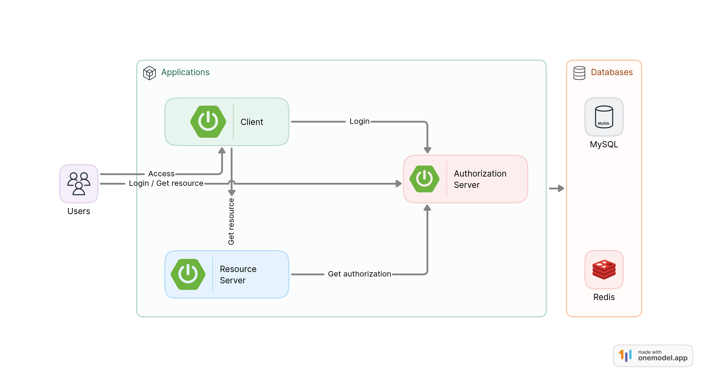

= Luix Passport

This project provides a standard authorization server based on https://datatracker.ietf.org/doc/html/draft-ietf-oauth-v2-1-07#section-1.1[OAuth 2.1 Authorization Server], featuring a resource server and client configuration powered by Spring Authorization Server and Spring Boot 4. It supports traditional credentials login as well as social login integrations.

[[website]]
== Official Website
https://passport.luixtech.cn

[[repository]]
== Code Repository
https://github.com/pm6422/luix-passport

[[snapshots]]
== Snapshots
image::images/demo.gif[]

[[features]]
== Features

* **OAuth 2.1 Authorization Server**: Built on top of Spring Authorization Server with standard protocol support.
* **Social Login Support**:
** Google
** GitHub
* **Team Management**: Full-featured team capabilities including creating teams, inviting members, and managing team roles (`TEAM_OWNER`, `TEAM_MEMBER`).
* **RBAC (Role-Based Access Control)**: Fine-grained permission management using Roles and Permissions entities.
* **Security Audit Logs**: Comprehensive tracking of login events (success/failure), security actions, and threat monitoring.
* **User Management**: Profile management, avatar upload, and customizable user settings.
* **Modern Frontend**: A responsive and aesthetic UI built with React 19, Vite, and Tailwind CSS.
* **API Documentation**: Integrated OpenAPI (Swagger) documentation for easy API exploration.

[[requirements]]
== Requirements
Prior to building this project, ensure you have the following installed:

* **Java 25**: Install using https://sdkman.io/install[SDK Man]:
+
```bash
sdk install java 25.0.1-amzn
```
* **Node.js (v20+) & npm**: For frontend development and build scripts.
* **Docker & Docker Compose**: For running the complete stack easily.

[[tech-stack]]
== Tech Stack

=== Backend
* Java 25
* Spring Boot 4.0.0
* Spring Security OAuth2 Authorization Server 7.0.0
* PostgresSQL 18
* Liquibase (Database Migration)
* SpringDoc OpenAPI (Swagger)

=== Frontend
* React 19
* Vite 7
* Tailwind CSS 4
* Shadcn UI / Radix UI
* Zustand (State Management)
* React Hook Form + Zod

[[using-docker]]
== Quick Start (Docker)

Evaluate the full stack locally with a single command.

=== 1. Build Docker Images
Run the following command in the project root directory:
```bash
npm run docker:build
```
* Or if using an ARM (Apple Silicon) machine:
```bash
npm run docker:build:arm64
```

=== 2. Start Application Stack
Starts the Authorization Server, Resource Server, Client, and PostgresSQL database:
```bash
npm run all:up
```

To stop the stack:
```bash
npm run all:down
```

[[application-urls]]
== Accessing the Application

* **Authorization Server**: `http://127.0.0.1:4001`
* **Resource Server**: `http://127.0.0.1:4002`
* **Client App**: `http://127.0.0.1:4003`
* **API Documentation**: `http://127.0.0.1:4001/swagger-ui/index.html` (Swagger UI)

=== Default Accounts
|===
|Username |Password |Roles

|user
|user
|user

|admin
|admin
|user, admin
|===

[[architecture]]
== Application Architecture


[[client-registration]]
== Client Registration Configuration
The server comes with pre-configured OAuth2 clients for demonstration.

[cols="1,1,1,2,2", options="header"]
|===
| Config Name | Grant Type | Interactive | Main Purpose | Scope Example

| `messaging-client-oidc`
| `authorization_code`
| Yes
| OAuth2 OpenID Connect (OIDC) Login
| `openid, profile`

| `messaging-client-client-credentials`
| `client_credentials`
| No
| Server-to-Server Communication
| `message:read, write`

| `messaging-client-authorization-code`
| `authorization_code`
| Yes
| API Authorization
| `message:read`
|===

[[social-login]]
== Social Login Configuration
To enable social login, configure `src/main/resources/config/application.yml` or set the corresponding environment variables.

=== Google
Set `GOOGLE_CLIENT_ID` and `GOOGLE_CLIENT_SECRET`.

* **Redirect URI**: `http://localhost:4001/login/oauth2/code/google-idp`

=== GitHub
Set `GITHUB_CLIENT_ID` and `GITHUB_CLIENT_SECRET`.

* **Redirect URI**: `http://localhost:4001/login/oauth2/code/github-idp`

[[references]]
== References
* https://docs.spring.io/spring-security/reference/index.html[Spring Security Reference]
* https://oauth.net/code/java/[OAuth Libraries for Java]
* https://www.toutiao.com/article/6848835275460706827/[How to design a generic permission management system]

[[thanks]]
== Thanks
Thanks for the license provided by JetBrains.

image::https://images.gitee.com/uploads/images/2020/0406/220236_f5275c90_5531506.png[JetBrains]
